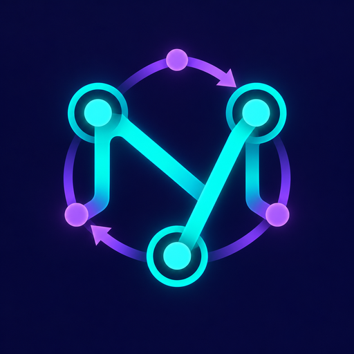

<h1 align="center">
  <br>
  
  <br>
  <b>Nexus</b>
  <br>
</h1>

<p align="center">
  A transactional reactive runtime for TypeScript, with optional Frida instrumentation adapters.
</p>

<p align="center">
  
  
  
  
  
  
</p>

---

## Overview

**Nexus** coordinates state, events, and reactive handlers through explicit transactions. A dispatcher applies changes atomically, then schedules reactions. The optional Frida adapters build on the same runtime for Native, Java, and IL2CPP instrumentation.

The library is published as a **versioned CommonJS `.tgz` package attached to GitHub Releases**. It is **not published to the public npm registry** (`private: true`). Install the downloaded archive in other projects; do not assume `npm install nexus` refers to this library.

This repository also contains two consumer applications, **C AST** and **Dining Philosophers**, which are tested against a **packed copy** of Nexus instead of importing its source tree.

---

## Features

- **Transactional stores:** state is read or changed through a `Context`, not mutated directly.
- **Events:** transient signals for workflows, separate from retained store state.
- **Reactive handlers:** configure triggers, execution mode (`inline` / `deferred`), and delivery (`latest` / `each`).
- **Atomic commits:** validate changes before publication; schedule reactions after successful commits.
- **Scoped lifetimes:** registrations and owned resources can be released explicitly.
- **Causality-aware scheduling:** distinguish a committed transaction from its managed downstream reactions.
- **Optional Frida adapters:** Native hooks, module observation, Java hooks, and IL2CPP hooks.
- **TypeScript declarations:** `.d.ts` files accompany the compiled JavaScript package.

---

## Table of Contents

1. [Repository Structure](#repository-structure)
2. [Download and Installation](#download-and-installation)
3. [Quick Start](#quick-start)
4. [Public Package Entry Points](#public-package-entry-points)
5. [Example Applications](#example-applications)
6. [Architecture](#architecture)
7. [Frida Integration](#frida-integration)
8. [Development and Testing](#development-and-testing)
9. [Limitations](#limitations)
10. [Documentation](#documentation)
11. [Contributing](#contributing)
12. [License](#license)

---

## Repository Structure

```text
nexus/
├── assets/
│   └── nexus-icon.png              # Explicitly approved project icon
├── src/
│   ├── core/                       # Dispatcher, transactions, scheduling
│   └── frida/                      # Optional instrumentation adapters
├── tests/                          # Library test suite
├── examples/                       # Library development examples
├── c-ast/                           # Standalone consumer of nexus/core
│   ├── language/
│   ├── nexus/
│   ├── tests/
│   └── package.json
├── dining-philosophers/            # React/Vite consumer of nexus/core
│   ├── domain/
│   ├── nexus/
│   ├── ui/
│   └── package.json
├── scripts/                         # Validation and package tooling
├── .github/workflows/              # CI and GitHub Release automation
└── package.json
```

`dist/`, `node_modules/`, generated `.tgz` archives and non-approved images are ignored by Git. The logo is the only explicitly allowlisted PNG. The published package includes compiled `dist/src/`, this README, the logo, and the license/architecture files—not the test applications or sample agents.

---

## Download and Installation

### From a GitHub Release

Download `nexus-0.1.20.tgz` from the **v0.1.20** GitHub Release, then run in the consumer project:

```bash
npm install ./nexus-0.1.20.tgz
```

Alternatively, install using the full URL of that release asset. For reproducible local installs, keep the tarball in a folder committed to the consuming project, or use a stable downloadable URL.

> **Package rename:** starting in v0.1.19 the package is `nexus`, previously `nexus-prototype` (v0.1.18). Update old imports and remove the old dependency when migrating.

### Build the archive from source

```bash
npm ci
npm run build
npm run check:release
npm pack --ignore-scripts
```

The resulting `nexus-0.1.20.tgz` is a standard installable npm package; `npm pack` does **not** publish it to the registry.

---

## Quick Start

**JavaScript (CommonJS)** — after installing the tarball:

```js
const { Dispatcher, Handler } = require('nexus/core');

const dispatcher = new Dispatcher();
const scope = dispatcher.scope();
const counter = scope.store(0);

class LogCounter extends Handler {
  run(ctx) {
    const value = ctx.read(counter);
    ctx.effect(() => console.log('Committed counter:', value));
  }
}

scope.register(new LogCounter(), {
  on: { any: [counter] },
  execution: 'inline',
});

dispatcher.inline(ctx => ctx.set(counter, 1));
console.log(dispatcher.inline(ctx => ctx.read(counter))); // 1
scope.dispose();
```

**TypeScript:**

```ts
import { Dispatcher, Handler, type Store } from 'nexus/core';
```

`Dispatcher.inline()` completes its commit synchronously. `submit()` queues a transaction; `submitAndWait()` additionally waits for Nexus-managed causal descendants. These methods do not wait for unrelated timers or external I/O.

---

## Public Package Entry Points

| Import | Purpose |
| --- | --- |
| `nexus` | Public Core and Frida exports |
| `nexus/core` | `Dispatcher`, `Store`, `Event`, `Handler`, `Scope`, `Context` |
| `nexus/frida` | Native, Java, and IL2CPP adapters |
| `nexus/frida-adapter` | Compatibility adapter entry point |

The package ships compiled **CommonJS JavaScript** and TypeScript declarations. Deep imports into internal modules are **not supported**.

---

## Example Applications

Both demo projects import **`nexus/core`** from their own `node_modules/nexus` directory. The repository test workflow creates an npm tarball and installs its contents for these smoke tests; no application reaches into `../src/core`.

### C AST parser

A step-driven lexer and parser for a **subset of C**, orchestrated with Nexus events and transactional stores. The parser keeps the grammar and lexer in its own `language/` folder.

```bash
# From the Nexus repository root:
npm run build
npm run prepare:examples
npm run c-ast:test
npm run c-ast:parse -- c-ast/fixtures/factorial.c --stdout
```

See [C AST documentation](c-ast/README.md). It is an experiment, **not** a full C11/C17 compiler.

### Dining Philosophers

A React/Vite demonstration of competing resource requests and atomic fork allocation using the Nexus scheduler.

```bash
# From the Nexus repository root (generates the tarball and installs demo dependencies):
npm run examples:install
npm run philosophers:test
npm run philosophers:build
npm run philosophers:dev
```

See [Dining Philosophers documentation](dining-philosophers/README.md). The virtual-time simulation tests logical concurrency, not OS-thread synchronization.

When running these applications outside this repository, update their `nexus` dependency to point at the downloaded release tarball or your own stable release URL.

---

## Architecture

```text
 Application / Frida bridge
           │
           ▼
    Dispatcher + Scope
           │
    ┌──────┴───────┐
    ▼              ▼
 Store<T>       Event<T>
    │              │
    └──────┬───────┘
           ▼
       Handler
           │
           ▼
  Transaction Context
           │
           ▼
     Atomic Commit
           │
           ▼
   Scheduled Reactions
```

Handlers are synchronous. Keep state transitions in transactions, and use `ctx.effect()` for work that should run **only after a successful commit**. External side effects cannot be rolled back by Nexus.

Details: [Architecture](ARCHITECTURE.md) and [internal architecture notes](docs/ARCHITECTURE.md).

---

## Frida Integration

The `nexus/frida` entry point exposes APIs including `attachHook`, `observeModule`, `attachJavaHook`, and `attachIl2CppHook`. Frida's runtime APIs are supplied by the embedding environment, not by Nexus.

To build the illustrative Frida agents from this repository:

```bash
npm run build:agent
npm run smoke:agent
```

These generate local bundles in `dist/agents/`. **They are not included in the GitHub release package.** The sample Native hooks contain unverified offsets and ABI assumptions; the smoke test uses a mocked host, not a physical device. See [real-device testing instructions](scripts/e2e/README.md) before attempting device integration.

---

## Development and Testing

**Requirements:** Node.js **22.16.0 or newer** and npm. Dependencies are locked in `package-lock.json`.

```bash
npm ci
npm run typecheck
npm run test:all        # includes the two packed-package consumer tests
npm run check:release   # checks the tarball file allowlist
```

`test:all` builds the library, verifies the API and architecture, runs unit/integration and mocked Frida tests, **packs the library**, and tests both standalone examples against the packed version. The GitHub Actions workflow additionally checks the React/Vite build after installing its dependencies.

For standalone consumer installs, first generate the root archive (`npm run build && npm pack --ignore-scripts`), then use `npm ci` in `c-ast/` or `dining-philosophers/`. Their package manifests refer to `../nexus-0.1.20.tgz`.

---

## Limitations

- Nexus is an early release; production-grade Frida compatibility has **not** been established for every target.
- Snapshot operations can copy an entire Map; consider the cost for very large states.
- `Scope.dispose()` does not cancel unrelated async work already running elsewhere.
- External bridge calls and I/O cannot be undone by transaction rollback.
- CommonJS is the supported distribution format; pure ESM integration may require build-tool interop.

---

## Documentation

- [Architecture overview](ARCHITECTURE.md)
- [Internal architecture details (Russian)](docs/ARCHITECTURE.md)
- [Nexus guide (Russian)](docs/NEXUS_GUIDE_RU.md)
- [Changelog](CHANGELOG.md)
- [Release checklist](RELEASE_CHECKLIST.md)
- [Security policy](SECURITY.md)
- [Contribution guidelines](CONTRIBUTING.md)

---

## Contributing

Contributions and bug reports are welcome. Please read [CONTRIBUTING.md](CONTRIBUTING.md), run `npm run test:all`, and keep changes to the public API intentional and documented.

---

## License

Released under the [MIT License](LICENSE.md). Copyright © 2026 Nexus contributors.

---

<p align="center">
  Built with TypeScript · Designed for transactional state, events, and reactive workflows.
</p>
